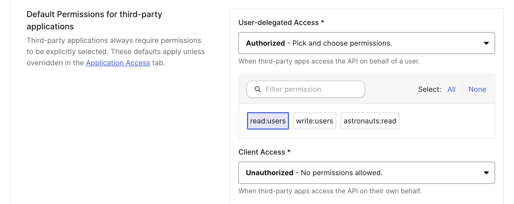
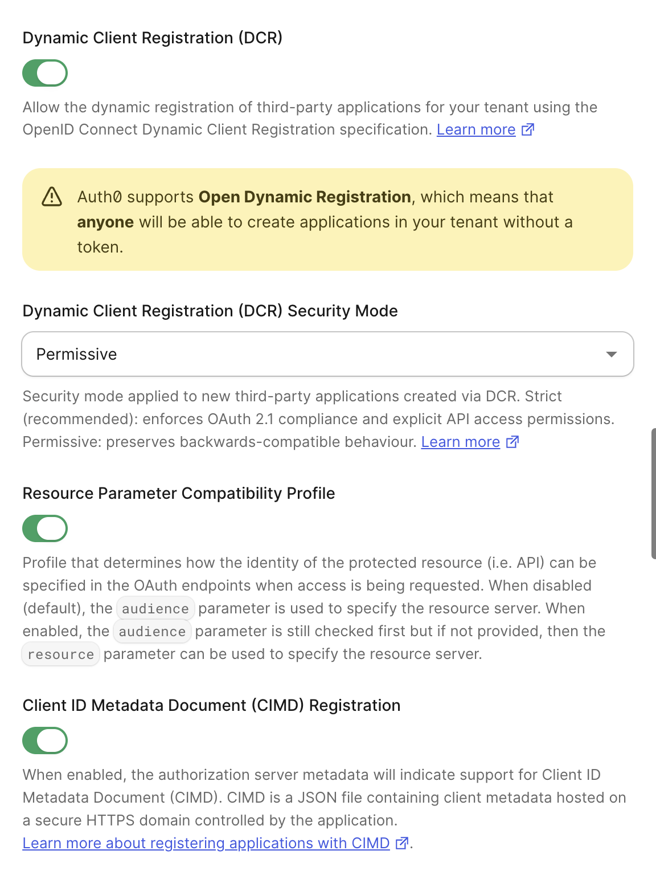
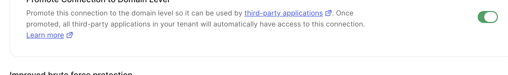

## Example: Auth0

This guide uses [Auth0](https://auth0.com/) as the Identity Provider.

### Pre-requisites

1. [Create an Apollo account](https://studio.apollographql.com/signup?referrer=docs-content).

1. Clone the repo for the example project.

   ```sh showLineNumbers=false
   git clone git@github.com:apollographql/apollo-mcp-server.git
   ```

1. Install or update the Rover CLI. You need at least v0.37 or later.

   ```sh showLineNumbers=false
   curl -sSL https://rover.apollo.dev/nix/latest | sh
   ```

### Step 1: Set up the Auth0 identity provider

[Create an Auth0 account](https://auth0.com/).

#### Find your Auth0 domain

1. In your Auth0 dashboard, navigate to **Applications** -> **APIs**.
1. Find the **Auth0 Management API** in the list. Its **API Audience** looks something like `https://dev-123456.us.auth0.com/api/v2/`, where `dev-123456` is your tenant name.
1. Copy the host part of this URL, for example `dev-123456.us.auth0.com`. This guide refers to it as `<AUTH0 DOMAIN>`.

#### Create the Auth0 API

1. On the same **APIs** page, click **Create API**.
1. Give it a friendly name like `Apollo MCP Server`.
1. For the **Identifier** field, Auth0 recommends using a URL. MCP clients send this value as the `resource` parameter, and Auth0 puts it in the `aud` claim of the access token. For this guide, use `http://127.0.0.1:8000/mcp`, the URL of your MCP server.
1. Leave the defaults for the rest of the fields and click **Create**.
1. On the new API's **Permissions** tab, add a permission named `read:users` with a description like `Read users`, then click **Add**. The MCP server requires this scope in [Step 2](#step-2-configure-the-mcp-server-for-authorization). Auth0 only includes scopes in an access token when the API defines them.
1. On the API's **Settings** tab, find **Default Permissions for third-party applications**. Set **User-delegated Access** to **Authorized - Pick and choose permissions.**, select `read:users`, and click **Save**. MCP clients register as third-party applications, and third-party applications can only get the permissions you select here.

   

#### Configure the tenant for MCP clients

1. Navigate to **Settings** -> **Advanced**. Changes to the toggles on this tab take effect immediately.
1. Toggle on **Resource Parameter Compatibility Profile**. MCP clients identify your MCP server with the standard `resource` parameter, but by default Auth0 only reads its own `audience` parameter. With this profile, Auth0 uses `resource` when a request has no `audience`, so it issues a JWT for your API.
1. Toggle on **Client ID Metadata Document (CIMD) Registration**. With CIMD, an MCP client uses an HTTPS URL as its client ID, and that URL hosts the client's metadata. The MCP specification recommends CIMD. Auth0 only accepts CIMD clients that you import first. For more information, see [Import CIMD clients](#import-cimd-clients).
1. Toggle on **Dynamic Client Registration (DCR)** and keep **Dynamic Client Registration (DCR) Security Mode** set to **Strict**, which Auth0 recommends. DCR lets a client register itself and get a new client ID. 
  - You should select the registration mechanism your MCP clients support. MCP Inspector uses DCR unless you configure a CIMD metadata URL for it. `mcp-remote` supports only DCR. For more information, see the Auth0 documentation on [dynamic client registration](https://auth0.com/docs/get-started/applications/dynamic-client-registration#enable-dynamic-client-registration).

   

1. Toggle on **Enable Application Connections**. New applications, including the ones MCP clients register, then get access to your existing connections.

<Note>

You don't need to set a tenant-wide **Default Audience** under **Settings** -> **General**. A default audience applies to every authorization request in the tenant, which can change the behavior of your other applications. The Resource Parameter Compatibility Profile scopes the audience to the MCP server that the client requests.

</Note>

#### Import CIMD clients

Unlike DCR, Auth0 doesn't register a CIMD client the first time it signs in. Before an MCP client can use CIMD, import it into your tenant:

1. Navigate to **Applications** -> **Applications** and click **Create application**.
1. Select **Import from URL**.
1. Enter the client's metadata URL, which is the HTTPS URL that the client uses as its client ID. Click **Preview**.
1. Check the metadata that Auth0 shows, then click **Create**.

Auth0 creates the client as a third-party application in Strict mode, so the default permissions you set on your API apply to it. Repeat these steps for each CIMD client you want to allow.

This guide's clients use DCR, so you don't need to import anything to follow the rest of the guide.

#### Set up the Auth0 connection

The Auth0 Connection is the method users use to sign in. This guide uses the default **Username-Password-Authentication** connection.

1. Navigate to **Authentication** -> **Database** and select **Username-Password-Authentication**.
1. Click **Try Connection** and sign up with an email and a password. You use these credentials to sign in later.
1. On the **Settings** tab, toggle on **Promote Connection to Domain Level** and click **Save**. Applications that MCP clients register are third-party applications, and they can only use domain-level connections.

   

Your Auth0 setup is now complete. You have an API with a permission, client registration for MCP clients, and a connection for authentication.

### Step 2: Configure the MCP server for authorization

Configure the MCP server to use the Auth0 instance for authentication.

1. Open the example repo you cloned earlier.
1. In the `examples/TheSpaceDevs` directory, open the `config.yaml` file.
1. Add the following `auth` configuration under the `transport` key:

   ```yaml title="examples/TheSpaceDevs/config.yaml"
   transport:
     type: streamable_http

     auth:
       servers:
         - https://<AUTH0 DOMAIN> # Fill in your Auth0 domain
       audiences:
         - http://127.0.0.1:8000/mcp # Must match your Auth0 API identifier
       resource: http://127.0.0.1:8000/mcp
       scopes:
         - read:users # Must be a permission defined on your Auth0 API
   ```

1. Replace the `<AUTH0 DOMAIN>` with your own Auth0 domain from earlier.

The MCP server advertises `read:users` to clients in its `WWW-Authenticate` challenge and Protected Resource Metadata. Clients request this scope from Auth0, and the user approves it on the consent screen.

Your MCP server is now configured to use Auth0 for authentication.

### Step 3: Configure the router for JWT authentication

Configure your GraphOS Router to validate JWTs issued by Auth0. This involves setting up the JWKS endpoint and defining the authorization rules.

#### Define authorization and authentication rules in the router

1. In the `examples/TheSpaceDevs` directory, create a new file called `router.yaml`.
1. Paste the following configuration, replacing `<AUTH0 DOMAIN>` with your Auth0 domain:

   ```yaml title="examples/TheSpaceDevs/router.yaml"
   authorization:
     require_authentication: true # Enforces authentication on all requests
   authentication:
     router:
       jwt:
         jwks:
           - url: https://<AUTH0 DOMAIN>/.well-known/jwks.json
             audiences:
               - http://127.0.0.1:8000/mcp # Only accept tokens issued for this API
   homepage:
     enabled: false
   sandbox:
     enabled: true
   supergraph:
     introspection: true
   ```

   With this configuration, the router requires authentication for all requests. If a request doesn't include an Authorization token, the router returns an `UNAUTHENTICATED` error.

#### Retrieve your GraphOS license credentials for auth

You need a graph's credentials and a valid GraphOS plan to use the router's authentication features.

1. Navigate to [GraphOS Studio](https://studio.apollographql.com/) and log in.
1. Click **Add graph** and **Connect an existing graph**.
1. Give it a name and click **Next**.
1. In the next modal, find the command that looks something like this:

   ```sh showLineNumbers=false {2}
   APOLLO_KEY=<YOUR_APOLLO_KEY> \
   rover subgraph publish <YOUR_APOLLO_GRAPH_REF> \
   --schema ./products-schema.graphql \
   --name your-subgraph-name \
   --routing-url http://products.prod.svc.cluster.local:4001/graphql
   ```

   Note: You don't need to run this command.

1. Retrieve the values for `YOUR_APOLLO_KEY` and `YOUR_APOLLO_GRAPH_REF` from the modal and click **Finish later**.

#### Run the MCP server and router

1. Back in your terminal, in the root of the project directory, replace and run the following command to start the MCP Server and the router together:

   ```sh
   APOLLO_GRAPH_REF=<YOUR_APOLLO_GRAPH_REF> APOLLO_KEY=<YOUR_APOLLO_KEY> \
   rover dev --supergraph-config ./examples/TheSpaceDevs/supergraph.yaml \
   --router-config ./examples/TheSpaceDevs/router.yaml \
   --mcp ./examples/TheSpaceDevs/config.yaml
   ```

1. Test the router by navigating to `http://localhost:4000` in your browser. You should see the Explorer, where you can run GraphQL queries against the router.

1. Remember, the router is configured to require authentication on all requests. Any operations without a valid Authorization token returns an `UNAUTHENTICATED` error. Run the operation:

   ```graphql
   query GetAstronautsCurrentlyInSpace {
     astronauts(filters: { inSpace: true, search: "" }) {
       results {
         id
         name
         timeInSpace
         lastFlight
       }
     }
   }
   ```

1. You should see an `UNAUTHENTICATED` error, which means the router is correctly enforcing authentication.

### Step 4: Make requests with MCP Inspector

1. In a new terminal window, run the MCP Inspector:

   ```sh
   npx @modelcontextprotocol/inspector
   ```

   The browser should open automatically with a proxy auth token.

1. In the MCP Inspector, select `Streamable HTTP` as the Transport Type and enter `http://127.0.0.1:8000/mcp` as the URL.
1. Click **Connect**. This triggers the OAuth flow, and you are redirected to the Auth0 login page.
1. Log in with the credentials you set up in the Auth0 connection and allow MCP Inspector access.
1. After you connect, the browser redirects back to MCP Inspector.
1. Click **List Tools** to see the available tools.
1. Select the `GetAstronautsCurrentlyInSpace` tool listed and click **Run Tool**.
1. You should see the results of the query, which means the authentication is working correctly.

You can select the **Auth** tab in MCP Inspector to see the details of the authenticated user and the scopes granted.

<ExpansionPanel title="Alternative: Guided OAuth flow in MCP Inspector">

You can also use the guided OAuth flow in MCP Inspector to test authentication. This gives you a detailed look into each step the client does to connect to the server.

1. Click **Open Auth Settings**.
1. In the **OAuth Flow Progress** section, click **Continue** to start the **Metadata Discovery** step.
1. Click **Continue** to start the **Client Registration** step. Expand the **Registered Client Information** step to note the `client_id` value.
1. Click **Continue** to start the **Preparing Authorization** step. Click the link to open up a new tab to authorize MCP Inspector.
1. Copy the authorization code and return to MCP Inspector.
1. Paste the code in the next step **Request Authorization and acquire authorization code** then click **Continue**.
1. Click **Continue** to start the **Token Request** step. This completes the authentication flow.

</ExpansionPanel>

### Step 5: Make requests with an MCP client (Goose)

We'll use [Goose](https://block.github.io/goose/) as our MCP Client. Goose allows you to choose between many different LLMs and provides some built-in functionality for connecting to MCP servers, called [Extensions](https://block.github.io/goose/docs/getting-started/using-extensions).

[Install the Goose CLI](https://block.github.io/goose/docs/getting-started/installation), following the instructions for your operating system. Set up the LLM provider of your choice with `goose configure` --> **Configure Providers**. Each provider has its own set of instructions, rate limiting and pricing.

Then, continue with the following steps:

1. In your terminal, run `goose configure`.
1. Select or enter the following answers at the prompts:

| Prompt                                                      | Answer                                     |
| ----------------------------------------------------------- | ------------------------------------------ |
| "What would you like to configure?"                         | "Add Extension"                            |
| "What type of extension would you like to add?"             | "Command Line Extension"                   |
| "What would you like to call this extension?"               | "mcp-auth-quickstart"                      |
| "What command should be run?"                               | `npx mcp-remote http://127.0.0.1:8000/mcp` |
| Other prompts (timeout, description, environment variables) | Use the default values                     |

1. To start Goose, type `goose`. This will open a browser window and send you through the auth flow.
1. Log in to your Auth0 instance and authorize your MCP server to gain access to your tools.
1. In Goose, ask "What astronauts are in space right now?". This question is similar to the `GetAstronautsCurrentlyInSpace` operation from earlier, which fails as unauthenticated without the proper token.
1. Goose will select the `GetAstronautsCurrentlyInSpace` tool and respond with information about the astronauts found in TheSpaceDevs.

## Troubleshooting

### Common issues

#### MCP server won't start

- **Error**: "Port 8000 is already in use"
  - Solution: Kill any existing processes using port 8000 or specify a different port with the `transport.port` option or `APOLLO_MCP_TRANSPORT__PORT` env variable
- **Error**: "Failed to load supergraph configuration"
  - Solution: Verify you're running the command from the repo root directory
  - Solution: Check that the path to `supergraph.yaml` is correct
- **Error**: "License violation"
  - Solution: Ensure that the `rover dev` command includes valid `APOLLO_KEY` and `APOLLO_GRAPH_REF` values and that your plan supports authentication features.
- **Error**: "What URL is your subgraph running on?" question in terminal
  - Solution: Verify that the file path for your config files is correct. You should run the `rover dev` command from the root of the example project directory and the file paths should be relative to that root.

#### MCP Server rejects the token

- **Issue**: The OAuth flow completes, but requests to the MCP server fail with `401 Unauthorized`
  - Solution: Check that **Resource Parameter Compatibility Profile** is on under **Settings** -> **Advanced**. Without it, Auth0 ignores the `resource` parameter and doesn't issue a JWT for your API.
  - Solution: Check that the Auth0 API identifier, `audiences`, and `resource` use exactly the same URL, including the scheme, host, port, and path. For example, `localhost` and `127.0.0.1` don't match.
- **Issue**: Requests fail with `403 Forbidden` and an `insufficient_scope` error
  - Solution: Check that every scope in the `scopes` configuration is a permission on your Auth0 API's **Permissions** tab. Auth0 leaves scopes that the API doesn't define out of the access token.

#### MCP Inspector connection issues

- **Error**: "Failed to connect to server"
  - Solution: Ensure the MCP server is running (check terminal output)
  - Solution: Verify you're using the correct URL (`http://127.0.0.1:8000/mcp`)
  - Solution: Check if your firewall is blocking the connection

#### Client registration or sign-in fails

- **Issue**: MCP Inspector or Goose fails at the client registration step
  - Solution: In your Auth0 dashboard, go to **Settings** -> **Advanced** and check that **Dynamic Client Registration (DCR)** is on. MCP Inspector (without a CIMD metadata URL) and `mcp-remote` fail if only **Client ID Metadata Document (CIMD) Registration** is on.
- **Issue**: The Auth0 error page says `invalid_request: Unknown client: https://...`
  - Solution: The client uses CIMD, and you haven't imported it. Follow the steps in [Import CIMD clients](#import-cimd-clients).
- **Issue**: Client registration fails with `403` and `"errorCode":"too_many_entities"`
  - Solution: Your tenant reached its application limit. Every DCR registration creates a new third-party application, so repeated testing fills the tenant quickly. Delete the applications you no longer need under **Applications** -> **Applications**.
- **Issue**: The Auth0 error page says `Client "tpc_..." is not authorized to access resource server "http://127.0.0.1:8000/mcp"`
  - Solution: On your Auth0 API's **Settings** tab, check that **Default Permissions for third-party applications** authorizes **User-delegated Access** for `read:users`, and that you saved the change.
- **Issue**: Client registration succeeds, but you can't sign in with your username and password
  - Solution: Check that **Promote Connection to Domain Level** is on for the **Username-Password-Authentication** connection.

### Infinite loop during OAuth flow

- **Issue**: After logging in to Auth0, MCP Inspector keeps refreshing and doesn't complete the OAuth flow
  - Solution: In MCP Inspector, open the **Authentication** panel in the sidebar. Clear out any values in the **Header Name** and **Bearer Token** fields. Then try connecting again.
  - Solution: In MCP Inspector, select **Clear OAuth State** and try connecting again.

### Getting help

If you're still having issues:

1. Check the [Apollo MCP Server GitHub issues](https://github.com/apollographql/apollo-mcp-server/issues).
2. Join the [Apollo Community MCP Server Category](https://community.apollographql.com/c/mcp-server/41).
3. Contact your Apollo representative for direct support.
