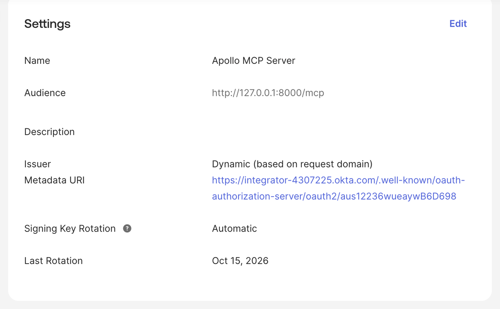
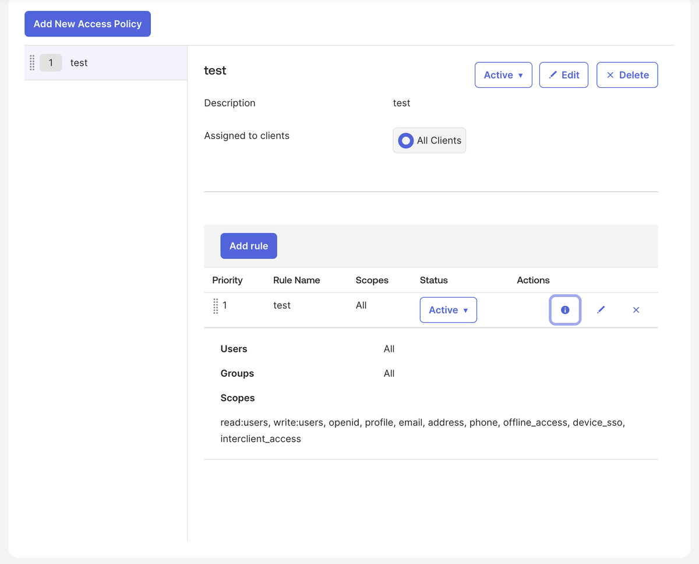
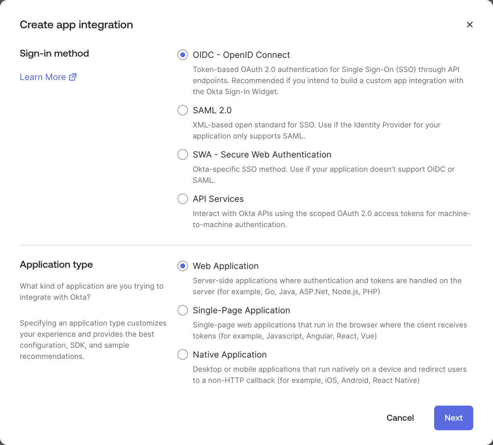
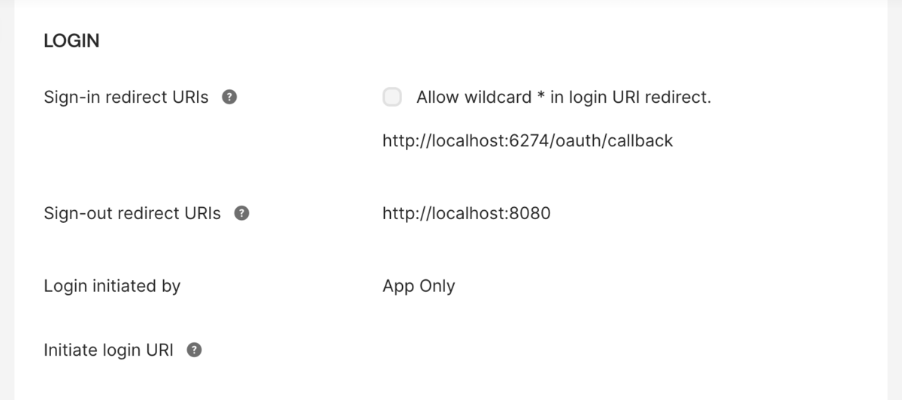
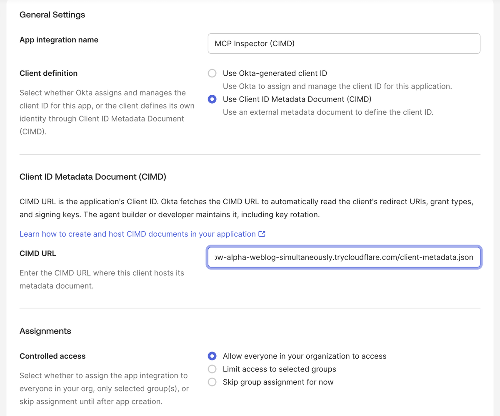

## Example: Okta

This guide uses [Okta Workforce Identity](https://www.okta.com/workforce-identity/) as the Identity Provider.

### How MCP clients register with Okta

An MCP client must identify itself to the authorization server before it starts the OAuth flow. The [MCP authorization specification](https://modelcontextprotocol.io/specification/2025-11-25/basic/authorization) defines three ways to do this:

- **Pre-registration**: An administrator creates an OAuth client in the authorization server ahead of time and gives its client ID to the MCP client.
- **Client ID Metadata Document (CIMD)**: The client uses an HTTPS URL as its client ID, and that URL hosts the client's metadata.
- **Dynamic Client Registration (DCR)**: The client sends its metadata to the authorization server's registration endpoint and gets a new client ID.

Okta's DCR endpoint requires an Okta API token that an administrator issues. MCP clients don't have this token, so they can't register themselves with Okta. For more information, see [MCP issue #695](https://github.com/modelcontextprotocol/modelcontextprotocol/issues/695).

Okta supports the other two methods:

- **Pre-registration**: You create an OAuth client in Okta, then enter its client ID and client secret in the MCP client. The main steps of this guide use this method with MCP Inspector.
- **CIMD**: You register the client's metadata document URL in Okta ahead of time. Okta doesn't accept a CIMD client that you haven't registered. For more information, see [Register CIMD clients](#register-cimd-clients).

### Pre-requisites

1. [Create an Apollo account](https://studio.apollographql.com/signup?referrer=docs-content).

1. Clone the repo for the example project.

   ```sh showLineNumbers=false
   git clone git@github.com:apollographql/apollo-mcp-server.git
   ```

1. Install or update the Rover CLI. You need at least v0.37 or later.

   ```sh showLineNumbers=false
   curl -sSL https://rover.apollo.dev/nix/latest | sh
   ```

### Step 1: Set up the Okta identity provider

If you don't have an Okta organization, [sign up for the Okta Integrator Free Plan](https://developer.okta.com/signup/). Your Okta domain looks something like `integrator-1234567.okta.com`. This guide refers to it as `<OKTA DOMAIN>`.

<Note>

Okta deactivates an Integrator Free Plan organization if nobody signs in to it for a while. Okta emails a warning before it deactivates the organization.

</Note>

#### Create the authorization server

An Okta authorization server issues the access tokens for your MCP server. Its audience goes in the `aud` claim of every token it issues.

1. In the Okta Admin Console, navigate to **Security** -> **API** -> **Authorization Servers**.
1. Click **Add Authorization Server**.
1. Give it a friendly name like `Apollo MCP Server`.
1. For **Audience**, enter `http://127.0.0.1:8000/mcp`, the URL of your MCP server. This value must match the `audiences` value in your MCP server configuration later.
1. Click **Save**.
1. On the **Settings** tab, copy the ID at the end of the **Metadata URI**, for example `aus1a2b3c4d5e6f7g8h9`. This guide refers to it as `<AUTHORIZATION SERVER ID>`. The issuer of this authorization server is `https://<OKTA DOMAIN>/oauth2/<AUTHORIZATION SERVER ID>`.

   

<Note>

Use a custom authorization server, not the Okta org authorization server at `https://<OKTA DOMAIN>/oauth2/v1`. Only a custom authorization server issues access tokens with your audience and custom scopes that other services can validate.

</Note>

#### Add a scope

1. On the authorization server's **Scopes** tab, click **Add Scope**.
1. For **Name**, enter `read:users`. The MCP server requires this scope in [Step 2](#step-2-configure-the-mcp-server-for-authorization).
1. Click **Create**.

Okta puts the granted scopes in the `scp` claim of the access token, as an array. Apollo MCP Server reads `scp` when a token has no `scope` claim. For more information, see [Scope claim: `scope` vs `scp`](/apollo-mcp-server/auth#scope-claim-scope-vs-scp).

#### Add an access policy

An Okta authorization server issues tokens only when an access policy rule allows the request.

1. On the authorization server's **Access Policies** tab, click **Add New Access Policy**.
1. Give it a name like `MCP clients`, assign it to **All clients**, and click **Create Policy**.
1. Click **Add rule**. Give it a name like `Allow MCP clients`.
1. Under **Grant type is**, keep **Authorization Code** selected.
1. Under **Scopes requested**, keep **Any scopes**, or select `read:users` and the other scopes that your MCP clients request.
1. Click **Create rule**.



#### Create an app integration for MCP Inspector

Because MCP Inspector can't register itself with Okta, you create its OAuth client yourself.

1. Navigate to **Applications** -> **Applications** and click **Create App Integration**.
1. For **Sign-in method**, select **OIDC - OpenID Connect**. For **Application type**, select **Web Application**. Click **Next**.

   

1. For **App integration name**, enter `MCP Inspector`.
1. Under **Grant type**, keep **Authorization Code** selected.
1. For **Sign-in redirect URIs**, add `http://localhost:6274/oauth/callback`, the redirect URI of MCP Inspector.

1. Under **Assignments**, select **Allow everyone in your organization to access**, or select the groups that can use MCP Inspector.
1. Click **Save**.
1. On the **General** tab, copy the **Client ID** and the **Client secret**. You enter them in MCP Inspector in [Step 4](#step-4-make-requests-with-mcp-inspector).



#### Register CIMD clients

Unlike DCR, CIMD doesn't let an unknown client register itself with Okta. Before an MCP client can use CIMD, register its metadata document URL:

1. Navigate to **Applications** -> **Applications** and click **Create App Integration**.
1. For **Sign-in method**, select **OIDC - OpenID Connect**. For **Application type**, select **Native Application**. Click **Next**.
1. For **App integration name**, enter a name for the client.
1. For **Client definition**, select **Use Client ID Metadata Document (CIMD)**.
1. For **CIMD URL**, enter the client's metadata document URL, which is the HTTPS URL that the client uses as its client ID.
1. Under **Assignments**, select **Allow everyone in your organization to access**, or select the groups that can use the client.
1. Click **Save**.
1. On the app integration's **Assignments** tab, check that your users or groups are assigned. If nobody is assigned, click **Assign** -> **Assign to Groups** and assign a group.



Okta reads the client's redirect URIs and grant types from the metadata document, so you don't enter them. The access policy that you assigned to **All clients** also applies to CIMD clients. Repeat these steps for each CIMD client you want to allow.

Your Okta setup is now complete. You have an authorization server with your audience, a scope, an access policy, and an OAuth client for MCP Inspector.

### Step 2: Configure the MCP server for authorization

Configure the MCP server to use your Okta authorization server for authentication.

1. Open the example repo you cloned earlier.
1. In the `examples/TheSpaceDevs` directory, open the `config.yaml` file.
1. Add the following `auth` configuration under the `transport` key:

   ```yaml title="examples/TheSpaceDevs/config.yaml"
   transport:
     type: streamable_http

     auth:
       servers:
         - https://<OKTA DOMAIN>/oauth2/<AUTHORIZATION SERVER ID> # The issuer of your authorization server
       audiences:
         - http://127.0.0.1:8000/mcp # Must match the audience of your authorization server
       resource: http://127.0.0.1:8000/mcp
       scopes:
         - read:users # Must be a scope defined on your authorization server
   ```

1. Replace `<OKTA DOMAIN>` and `<AUTHORIZATION SERVER ID>` with your own values from earlier.

The MCP server finds the token signing keys from the authorization server's discovery metadata at `https://<OKTA DOMAIN>/.well-known/oauth-authorization-server/oauth2/<AUTHORIZATION SERVER ID>`.

Your MCP server is now configured to use Okta for authentication.

### Step 3: Configure the router for JWT authentication

Configure your GraphOS Router to validate JWTs issued by Okta. This involves setting up the JWKS endpoint and defining the authorization rules.

#### Define authorization and authentication rules in the router

1. In the `examples/TheSpaceDevs` directory, create a new file called `router.yaml`.
1. Paste the following configuration, replacing `<OKTA DOMAIN>` and `<AUTHORIZATION SERVER ID>` with your own values:

   ```yaml title="examples/TheSpaceDevs/router.yaml"
   authorization:
     require_authentication: true # Enforces authentication on all requests
   authentication:
     router:
       jwt:
         jwks:
           - url: https://<OKTA DOMAIN>/oauth2/<AUTHORIZATION SERVER ID>/v1/keys
             audiences:
               - http://127.0.0.1:8000/mcp # Only accept tokens issued for this API
   homepage:
     enabled: false
   sandbox:
     enabled: true
   supergraph:
     introspection: true
   ```

   With this configuration, the router requires authentication for all requests. If a request doesn't include an Authorization token, the router returns an `unauthenticated` error with the `AUTH_ERROR` code.

#### Retrieve your GraphOS license credentials for auth

You need a graph's credentials and a valid GraphOS plan to use the router's authentication features.

1. Navigate to [GraphOS Studio](https://studio.apollographql.com/) and log in.
1. Click **Add graph** and **Connect an existing graph**.
1. Give it a name and click **Next**.
1. In the next modal, find the command that looks something like this:

   ```sh showLineNumbers=false {2}
   APOLLO_KEY=<YOUR_APOLLO_KEY> \
   rover subgraph publish <YOUR_APOLLO_GRAPH_REF> \
   --schema ./products-schema.graphql \
   --name your-subgraph-name \
   --routing-url http://products.prod.svc.cluster.local:4001/graphql
   ```

   Note: You don't need to run this command.

1. Retrieve the values for `YOUR_APOLLO_KEY` and `YOUR_APOLLO_GRAPH_REF` from the modal and click **Finish later**.

#### Run the MCP server and router

1. Back in your terminal, in the root of the project directory, replace and run the following command to start the MCP Server and the router together:

   ```sh
   APOLLO_GRAPH_REF=<YOUR_APOLLO_GRAPH_REF> APOLLO_KEY=<YOUR_APOLLO_KEY> \
   rover dev --supergraph-config ./examples/TheSpaceDevs/supergraph.yaml \
   --router-config ./examples/TheSpaceDevs/router.yaml \
   --mcp ./examples/TheSpaceDevs/config.yaml
   ```

1. Test the router by navigating to `http://localhost:4000` in your browser. You should see the Explorer, where you can run GraphQL queries against the router.

1. Remember, the router is configured to require authentication on all requests. Any operation without a valid Authorization token returns an `unauthenticated` error. Run the operation:

   ```graphql
   query GetAstronautsCurrentlyInSpace {
     astronauts(inSpace: true, search: "") {
       results {
         id
         name
         timeInSpace
         lastFlight
       }
     }
   }
   ```

1. You should see an `unauthenticated` error with the `AUTH_ERROR` code, which means the router is correctly enforcing authentication.

### Step 4: Make requests with MCP Inspector

1. In a new terminal window, run the MCP Inspector:

   ```sh
   npx @modelcontextprotocol/inspector
   ```

   Open the MCP Inspector URL that the command prints, `http://localhost:6274`. Use `localhost`, not `127.0.0.1`, so the redirect URI matches the one you registered in Okta.

1. Click **Add Servers** -> **+ Add manually**.
1. For **Server ID**, enter `apollo-okta`. For **Transport**, select `streamable-http`. For **URL**, enter `http://127.0.0.1:8000/mcp`. Click **Add**.
1. On the `apollo-okta` server card, click **Settings** and expand **OAuth Settings**.
1. Enter the **Client ID** and **Client Secret** of the MCP Inspector app integration from Step 1. MCP Inspector then uses this client instead of registering a new one.
1. For **Scopes**, enter `read:users`.
1. Check that **Redirect URI** is `http://localhost:6274/oauth/callback`, then close the settings.
1. Turn on the switch on the `apollo-okta` server card. This triggers the OAuth flow, and you are redirected to the Okta sign-in page.
1. Sign in with your Okta user and allow MCP Inspector access. If you already have an Okta session in the browser and you allowed access before, Okta skips both pages.
1. After the browser redirects back to MCP Inspector, the server card shows **Connected**.
1. Select the **Tools** view at the top of the page to see the available tools.
1. Select the `GetAstronautsCurrentlyInSpace` tool and click **Execute Tool**.
1. You should see the results of the query, which means the authentication is working correctly.

<ExpansionPanel title="Alternative: Connect MCP Inspector with CIMD">

MCP Inspector can identify itself with a client metadata document instead of a pre-registered client ID. Okta fetches this document, so you must host it at an HTTPS URL that Okta can reach. Okta can't fetch a document from `localhost`.

1. Host a metadata document like the following at an HTTPS URL. The `client_id` value must be the exact URL of the document, and `redirect_uris` must include the redirect URI of MCP Inspector.

   ```json title="client-metadata.json"
   {
     "client_id": "https://<YOUR HOST>/client-metadata.json",
     "client_name": "MCP Inspector",
     "redirect_uris": ["http://localhost:6274/oauth/callback"],
     "grant_types": ["authorization_code", "refresh_token"],
     "response_types": ["code"],
     "token_endpoint_auth_method": "none"
   }
   ```

1. Register the document URL in Okta. For more information, see [Register CIMD clients](#register-cimd-clients).
1. In MCP Inspector, click **Client settings** at the top of the page and expand **OAuth Client ID Metadata Document**.
1. Select **Use Client ID Metadata Document** and enter the document URL in **Client ID metadata document URL**.
1. Add a server for `http://127.0.0.1:8000/mcp` as in the previous steps. In its **OAuth Settings**, enter `read:users` for **Scopes**, and leave **Client ID** and **Client Secret** empty.
1. Turn on the switch on the server card and sign in to Okta.

If MCP Inspector connects without sending you to Okta, it reused tokens from an earlier connection to the same URL. In the server's **OAuth Settings**, click **Clear stored OAuth state**, then connect again.

</ExpansionPanel>

### Use other MCP clients

To connect another MCP client, create an app integration for it the same way you did for MCP Inspector. Use that client's redirect URIs, and enter its client ID in the client's configuration. Each MCP client has its own way to accept a pre-registered client ID, and some clients don't accept one. Check the documentation of your MCP client.

## Troubleshooting

### Common issues

#### MCP server won't start

- **Error**: "Port 8000 is already in use"
  - Solution: Kill any existing processes using port 8000 or specify a different port with the `transport.port` option or `APOLLO_MCP_TRANSPORT__PORT` env variable
- **Error**: "Failed to load supergraph configuration"
  - Solution: Verify you're running the command from the repo root directory
  - Solution: Check that the path to `supergraph.yaml` is correct
- **Error**: "License violation"
  - Solution: Ensure that the `rover dev` command includes valid `APOLLO_KEY` and `APOLLO_GRAPH_REF` values and that your plan supports authentication features.
- **Error**: "What URL is your subgraph running on?" question in terminal
  - Solution: Verify that the file path for your config files is correct. You should run the `rover dev` command from the root of the example project directory and the file paths should be relative to that root.

#### Client registration or sign-in fails

- **Issue**: MCP Inspector fails at the client registration step
  - Solution: Check that you entered the **Client ID** and **Client Secret** in the server's **OAuth Settings** before you connected. Without a client ID or a CIMD URL, MCP Inspector tries DCR, and Okta rejects the request because it has no Okta API token.
- **Issue**: MCP Inspector shows `Re-authentication required` with `Error: invalid_client. Details: Client authentication failed.`
  - Solution: MCP Inspector still has tokens or a client registration from an earlier connection to the same URL. In the server's **OAuth Settings**, click **Clear stored OAuth state**, then connect again.
- **Issue**: The Okta error page says `The 'redirect_uri' parameter must be a Login redirect URI in the client app settings`
  - Solution: Check that the app integration's **Sign-in redirect URIs** include the **Redirect URI** that MCP Inspector shows in its **OAuth Settings**. The value changes if you open MCP Inspector from `127.0.0.1` instead of `localhost`, or on a different port.
- **Issue**: The Okta error page says `Policy evaluation failed for this request`
  - Solution: Check that the authorization server has an active access policy that applies to the app integration, and an active rule that allows the Authorization Code grant and the scopes that the client requests.
- **Issue**: The Okta error page says `User is not assigned to the client application`
  - Solution: On the app integration's **Assignments** tab, assign your user or one of its groups. This also applies to the app integrations that you create for CIMD clients.

#### MCP Server rejects the token

- **Issue**: The OAuth flow completes, but requests to the MCP server fail with `401 Unauthorized`
  - Solution: Check that `servers` is the issuer of your custom authorization server, `https://<OKTA DOMAIN>/oauth2/<AUTHORIZATION SERVER ID>`, and not your Okta domain alone.
  - Solution: Check that the authorization server's **Audience** and the `audiences` value use exactly the same URL, including the scheme, host, port, and path. For example, `localhost` and `127.0.0.1` don't match.
- **Issue**: Requests fail with `403 Forbidden` and an `insufficient_scope` error
  - Solution: Check that every scope in the `scopes` configuration is a scope on your authorization server's **Scopes** tab, and that the access policy rule allows it.

#### MCP Inspector connection issues

- **Error**: "Failed to connect to server"
  - Solution: Ensure the MCP server is running (check terminal output)
  - Solution: Verify you're using the correct URL (`http://127.0.0.1:8000/mcp`)
  - Solution: Check if your firewall is blocking the connection

### Getting help

If you're still having issues:

1. Check the [Apollo MCP Server GitHub issues](https://github.com/apollographql/apollo-mcp-server/issues).
2. Join the [Apollo Community MCP Server Category](https://community.apollographql.com/c/mcp-server/41).
3. Contact your Apollo representative for direct support.
