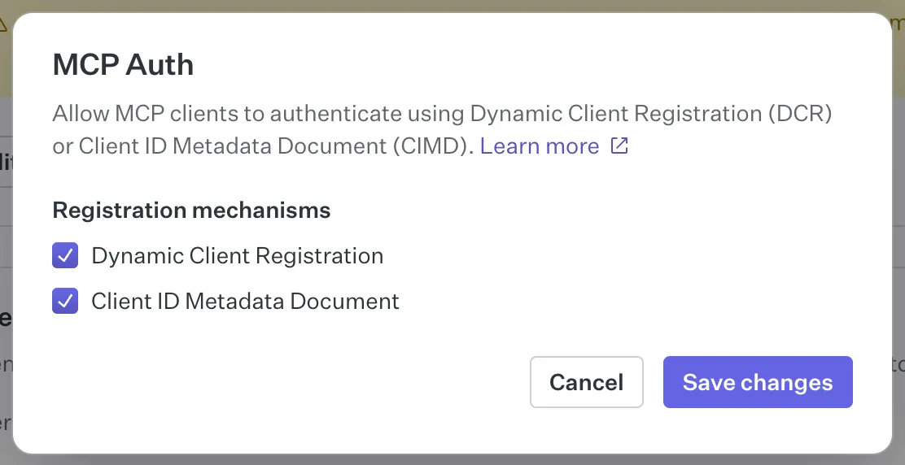
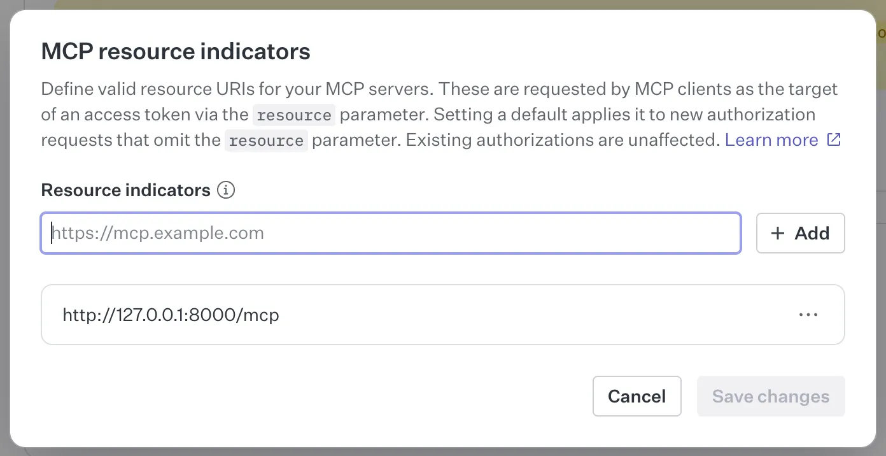

## Example: WorkOS

This guide uses [WorkOS AuthKit](https://workos.com/docs/authkit/mcp) as the Identity Provider.

### Pre-requisites

1. [Create an Apollo account](https://studio.apollographql.com/signup?referrer=docs-content).

1. Clone the repo for the example project.

   ```sh showLineNumbers=false
   git clone git@github.com:apollographql/apollo-mcp-server.git
   ```

1. Install or update the Rover CLI. You need at least v0.37 or later.

   ```sh showLineNumbers=false
   curl -sSL https://rover.apollo.dev/nix/latest | sh
   ```

### Step 1: Set up the WorkOS Identity Provider

[Create a WorkOS account](https://dashboard.workos.com/signup). This guide uses the default **Staging** environment.

#### Find your AuthKit domain

AuthKit is the WorkOS authorization server that MCP clients sign in with.

1. In the WorkOS Dashboard, navigate to **Domains**.
1. Under **AuthKit**, copy the domain. In a staging environment, it looks something like `necessary-marsh-61-staging.authkit.app`. This guide refers to it as `<AUTHKIT DOMAIN>`.
1. To check the domain, open `https://<AUTHKIT DOMAIN>/.well-known/oauth-authorization-server` in your browser. You should see a JSON document whose `issuer` value is `https://<AUTHKIT DOMAIN>`.

#### Enable client registration

MCP clients must identify themselves to AuthKit before they start the OAuth flow. WorkOS supports two registration methods:

- **Client ID Metadata Document (CIMD)**: The client uses an HTTPS URL as its client ID. AuthKit fetches the client's metadata from that URL, so the client doesn't need to register first. The MCP specification recommends CIMD.
- **Dynamic Client Registration (DCR)**: The client sends its metadata to AuthKit's registration endpoint and gets a new client ID. The MCP specification keeps DCR for backward compatibility with clients that don't support CIMD yet.

1. In the WorkOS Dashboard, navigate to **Connect** -> **Configuration**.
1. In the **MCP Auth** section, click **Manage**.
1. Under **Registration mechanisms**, select **Client ID Metadata Document**.
1. Select **Dynamic Client Registration** too. This guide's clients need it: MCP Inspector uses DCR unless you configure a CIMD metadata URL for it, and `mcp-remote`, which Goose uses in [Step 5](#step-5-make-requests-with-an-mcp-client-goose), supports only DCR.
1. Click **Save changes**.



<Note>

If all of your MCP clients support CIMD, you can leave **Dynamic Client Registration** cleared. AuthKit then accepts only clients that identify themselves with a metadata document URL.

</Note>

#### Add the MCP server as a resource indicator

A resource indicator tells AuthKit which URL a token is for. AuthKit puts this URL in the `aud` claim of the access token. The MCP server checks this claim against its `audiences` configuration.

1. On the same **Configuration** page, in the **MCP resource indicators** section, click **Edit MCP resources**.
1. Enter `http://127.0.0.1:8000/mcp` and click **Add**. This value must match the `resource` value in your MCP server configuration later.
1. Optional: Open the **...** menu next to the resource indicator and select **Set as default**. AuthKit then uses this audience for clients that don't send a `resource` parameter.
1. Click **Save changes**.



<Note>

If you don't configure a resource indicator, AuthKit sets the `aud` claim to your environment's client ID instead. You can find the client ID under **API Keys**.

</Note>

#### Create a test user

AuthKit hosts the sign-in page for your users. This guide uses email and password sign-in.

1. In the WorkOS Dashboard, navigate to **Authentication** -> **Methods**. Check that **Email + Password** is enabled.
1. Navigate to **Users** and click **Create user**.
1. Enter an email address and a password, then click **Create user**. You use these credentials to sign in later.

Your WorkOS setup is now complete. You have an AuthKit domain, a resource indicator for the MCP server, and a user to sign in with.

### Step 2: Configure the MCP Server for authorization

Configure the MCP server to use AuthKit for authentication.

1. Open the example repo you cloned earlier.
1. In the `examples/TheSpaceDevs` directory, open the `config.yaml` file.
1. Add the following `auth` configuration under the `transport` key:

   ```yaml title="examples/TheSpaceDevs/config.yaml"
   transport:
     type: streamable_http

     auth:
       servers:
         - https://<AUTHKIT DOMAIN> # Fill in your AuthKit domain
       issuers:
         - https://<AUTHKIT DOMAIN> # Fill in your AuthKit domain
       audiences:
         - http://127.0.0.1:8000/mcp # Must match your resource indicator
       resource: http://127.0.0.1:8000/mcp
   ```

1. Replace both `<AUTHKIT DOMAIN>` placeholders with your own AuthKit domain from earlier.

<Note>

This configuration doesn't set `scopes`, so the MCP server doesn't require any scope. AuthKit access tokens include a `scope` claim with the scopes the client was granted, for example `openid`. If you configure `scopes`, every value must appear in that claim. Otherwise, the MCP server returns `403 Forbidden` with an `insufficient_scope` error. For more information, see [Configure scope enforcement](/apollo-mcp-server/auth#configure-scope-enforcement).

</Note>

Your MCP server is now configured to use WorkOS for authentication.

### Step 3: Configure the router for JWT authentication

Configure your GraphOS Router to validate JWTs issued by AuthKit. This involves setting up the JWKS endpoint and defining the authorization rules.

#### Define authorization and authentication rules in the router

1. In the `examples/TheSpaceDevs` directory, create a new file called `router.yaml`.
1. Paste the following configuration, replacing `<AUTHKIT DOMAIN>` with your AuthKit domain:

   ```yaml title="examples/TheSpaceDevs/router.yaml"
   authorization:
     require_authentication: true # Enforces authentication on all requests
   authentication:
     router:
       jwt:
         jwks:
           - url: https://<AUTHKIT DOMAIN>/oauth2/jwks
             audiences:
               - http://127.0.0.1:8000/mcp # Only accept tokens issued for this resource
   homepage:
     enabled: false
   sandbox:
     enabled: true
   supergraph:
     introspection: true
   ```

   With this configuration, the router requires authentication for all requests. If a request doesn't include an Authorization token, the router returns an `UNAUTHENTICATED` error.

#### Retrieve your GraphOS license credentials for auth

You need a graph's credentials and a valid GraphOS plan to use the router's authentication features.

1. Navigate to [GraphOS Studio](https://studio.apollographql.com/) and log in.
1. Click **Add graph** and **Connect an existing graph**.
1. Give it a name and click **Next**.
1. In the next modal, find the command that looks something like this:

   ```sh showLineNumbers=false {2}
   APOLLO_KEY=<YOUR_APOLLO_KEY> \
   rover subgraph publish <YOUR_APOLLO_GRAPH_REF> \
   --schema ./products-schema.graphql \
   --name your-subgraph-name \
   --routing-url http://products.prod.svc.cluster.local:4001/graphql
   ```

   Note: You don't need to run this command.

1. Retrieve the values for `YOUR_APOLLO_KEY` and `YOUR_APOLLO_GRAPH_REF` from the modal and click **Finish later**.

#### Run the MCP Server and router

1. Back in your terminal, in the root of the project directory, replace and run the following command to start the MCP Server and the router together:

   ```sh
   APOLLO_GRAPH_REF=<YOUR_APOLLO_GRAPH_REF> APOLLO_KEY=<YOUR_APOLLO_KEY> \
   rover dev --supergraph-config ./examples/TheSpaceDevs/supergraph.yaml \
   --router-config ./examples/TheSpaceDevs/router.yaml \
   --mcp ./examples/TheSpaceDevs/config.yaml
   ```

1. Test the router by navigating to `http://localhost:4000` in your browser. You should see the Explorer, where you can run GraphQL queries against the router.

1. Remember, the router is configured to require authentication on all requests. Any operations without a valid Authorization token returns an `UNAUTHENTICATED` error. Run the operation:

   ```graphql
   query GetAstronautsCurrentlyInSpace {
     astronauts(filters: { inSpace: true, search: "" }) {
       results {
         id
         name
         timeInSpace
         lastFlight
       }
     }
   }
   ```

1. You should see an `UNAUTHENTICATED` error, which means the router is correctly enforcing authentication.

### Step 4: Make requests with MCP Inspector

1. In a new terminal window, run the MCP Inspector:

   ```sh
   npx @modelcontextprotocol/inspector
   ```

   The browser should open automatically with a proxy auth token.

1. In the MCP Inspector, select `Streamable HTTP` as the Transport Type and enter `http://127.0.0.1:8000/mcp` as the URL.
1. Click **Connect**. This triggers the OAuth flow, and you are redirected to the AuthKit sign-in page.
1. Sign in with the user you created in the WorkOS Dashboard and allow MCP Inspector access.
1. After you connect, the browser redirects back to MCP Inspector.
1. Click **List Tools** to see the available tools.
1. Select the `GetAstronautsCurrentlyInSpace` tool listed and click **Run Tool**.
1. You should see the results of the query, which means the authentication is working correctly.

You can select the **Auth** tab in MCP Inspector to see the details of the authenticated user and the access token.

<ExpansionPanel title="Alternative: Guided OAuth flow in MCP Inspector">

You can also use the guided OAuth flow in MCP Inspector to test authentication. This gives you a detailed look into each step the client does to connect to the server.

1. Click **Open Auth Settings**.
1. In the **OAuth Flow Progress** section, click **Continue** to start the **Metadata Discovery** step.
1. Click **Continue** to start the **Client Registration** step. Expand the **Registered Client Information** step to note the `client_id` value.
1. Click **Continue** to start the **Preparing Authorization** step. Click the link to open up a new tab to authorize MCP Inspector.
1. Copy the authorization code and return to MCP Inspector.
1. Paste the code in the next step **Request Authorization and acquire authorization code** then click **Continue**.
1. Click **Continue** to start the **Token Request** step. This completes the authentication flow.

</ExpansionPanel>

### Step 5: Make requests with an MCP Client (Goose)

We'll use [Goose](https://block.github.io/goose/) as our MCP Client. Goose allows you to choose between many different LLMs and provides some built-in functionality for connecting to MCP servers, called [Extensions](https://block.github.io/goose/docs/getting-started/using-extensions).

[Install the Goose CLI](https://block.github.io/goose/docs/getting-started/installation), following the instructions for your operating system. Set up the LLM provider of your choice with `goose configure` --> **Configure Providers**. Each provider has its own set of instructions, rate limiting and pricing.

Then, continue with the following steps:

1. In your terminal, run `goose configure`.
1. Select or enter the following answers at the prompts:

| Prompt                                                      | Answer                                     |
| ----------------------------------------------------------- | ------------------------------------------ |
| "What would you like to configure?"                         | "Add Extension"                            |
| "What type of extension would you like to add?"             | "Command Line Extension"                   |
| "What would you like to call this extension?"               | "mcp-auth-quickstart"                      |
| "What command should be run?"                               | `npx mcp-remote http://127.0.0.1:8000/mcp` |
| Other prompts (timeout, description, environment variables) | Use the default values                     |

1. To start Goose, type `goose`. This will open a browser window and send you through the auth flow.
1. Sign in to AuthKit and authorize your MCP server to gain access to your tools.
1. In Goose, ask "What astronauts are in space right now?". This question is similar to the `GetAstronautsCurrentlyInSpace` operation from earlier, which fails as unauthenticated without the proper token.
1. Goose will select the `GetAstronautsCurrentlyInSpace` tool and respond with information about the astronauts found in TheSpaceDevs.

## Troubleshooting

### Common Issues

#### MCP Server Won't Start

- **Error**: "Port 8000 is already in use"
  - Solution: Kill any existing processes using port 8000 or specify a different port with the `transport.port` option or `APOLLO_MCP_TRANSPORT__PORT` env variable
- **Error**: "Failed to load supergraph configuration"
  - Solution: Verify you're running the command from the repo root directory
  - Solution: Check that the path to `supergraph.yaml` is correct
- **Error**: "License violation"
  - Solution: Ensure that the `rover dev` command includes valid `APOLLO_KEY` and `APOLLO_GRAPH_REF` values and that your plan supports authentication features.
- **Error**: "What URL is your subgraph running on?" question in terminal
  - Solution: Verify that the file path for your config files is correct. You should run the `rover dev` command from the root of the example project directory and the file paths should be relative to that root.

#### MCP Inspector Connection Issues

- **Error**: "Failed to connect to server"
  - Solution: Ensure the MCP server is running (check terminal output)
  - Solution: Verify you're using the correct URL (`http://127.0.0.1:8000/mcp`)
  - Solution: Check if your firewall is blocking the connection

#### MCP Server returns `401 Unauthorized` after sign-in

- **Issue**: The OAuth flow completes, but every request to the MCP server fails with `401 Unauthorized`
  - Solution: Check that `http://127.0.0.1:8000/mcp` is listed under **Connect** -> **Configuration** -> **MCP resource indicators**. Without it, AuthKit sets the `aud` claim to your environment's client ID, which doesn't match `audiences`.
  - Solution: Check that the resource indicator, `audiences`, and `resource` use exactly the same URL, including the scheme, host, port, and path. For example, `localhost` and `127.0.0.1` don't match.
  - Solution: Check that `servers` and `issuers` use your AuthKit domain without a trailing slash.

#### MCP Server returns `403 Forbidden`

- **Issue**: Every tool call fails with `403 Forbidden` and an `insufficient_scope` error
  - Solution: Check that every value in `scopes` appears in the access token's `scope` claim. You can see the claim by decoding the token, for example on the **Auth** tab in MCP Inspector. To turn off the global scope requirement, remove `scopes` from the `auth` configuration.

#### Client registration fails

- **Issue**: MCP Inspector or Goose fails at the client registration step
  - Solution: In the WorkOS Dashboard, go to **Connect** -> **Configuration** and check that **MCP Auth** shows **Dynamic Client Registration** as **Enabled**. MCP Inspector (without a CIMD metadata URL) and `mcp-remote` fail if only **Client ID Metadata Document** is enabled.
  - Solution: If your client uses CIMD, check that **Client ID Metadata Document** is **Enabled** and that AuthKit can reach the client's metadata URL over HTTPS.

### Infinite loop during OAuth flow

- **Issue**: After signing in to AuthKit, MCP Inspector keeps refreshing and doesn't complete the OAuth flow
  - Solution: In MCP Inspector, open the **Authentication** panel in the sidebar. Clear out any values in the **Header Name** and **Bearer Token** fields. Then try connecting again.
  - Solution: In MCP Inspector, select **Clear OAuth State** and try connecting again.

### Getting Help

If you're still having issues:

1. Check the [Apollo MCP Server GitHub issues](https://github.com/apollographql/apollo-mcp-server/issues).
2. Join the [Apollo Community MCP Server Category](https://community.apollographql.com/c/mcp-server/41).
3. Contact your Apollo representative for direct support.
